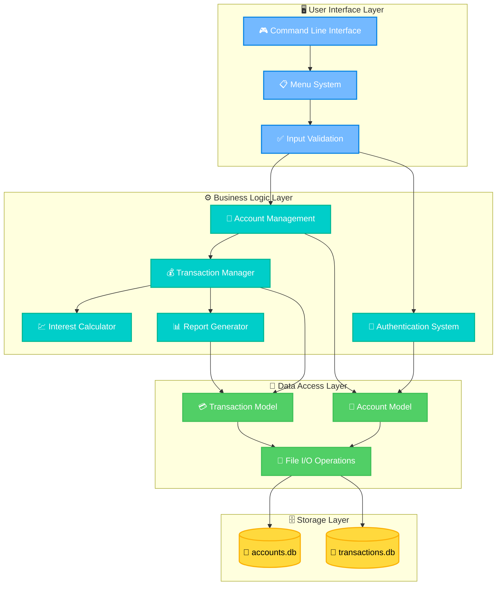
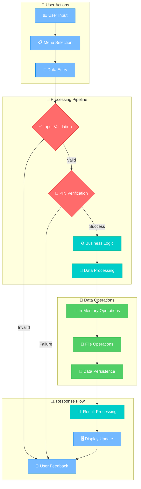
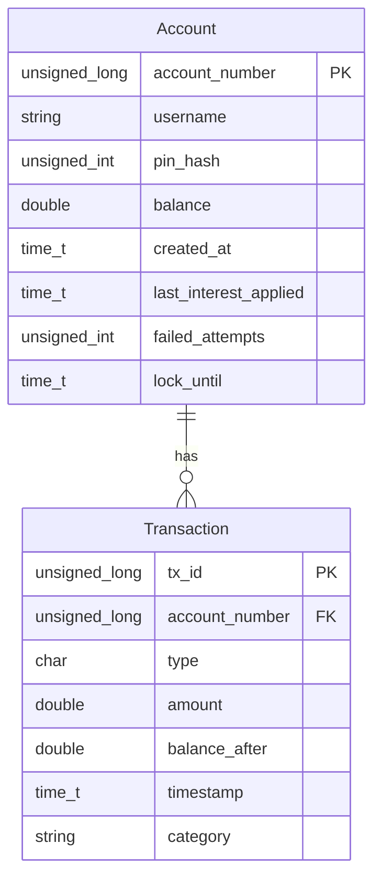

# 🏦 BankBuddy: Educational Banking Console Application

*A lightweight C banking application engineered for learning financial software development with clean architecture and secure data persistence.*

---

## 🏅 Badges


---

## 📚 Table of Contents

- [🏦 BankBuddy: Educational Banking Console Application](#-bankbuddy-educational-banking-console-application)
  - [🏅 Badges](#-badges)
  - [📚 Table of Contents](#-table-of-contents)
  - [🎯 Objective](#-objective)
  - [💡 Expected Benefit](#-expected-benefit)
  - [🚀 Features](#-features)
  - [🗂️ Project Structure](#️-project-structure)
  - [🧠 Architecture](#-architecture)
  - [⚙️ Installation](#️-installation)
  - [🚀 Usage](#-usage)
  - [📚 Examples](#-examples)
  - [🔧 Configuration](#-configuration)
  - [🔮 Future Improvements](#-future-improvements)
  - [🛠 Troubleshooting](#-troubleshooting)
  - [🤝 Contributing](#-contributing)
  - [📜 License](#-license)

---

## 🎯 Objective

BankBuddy enables students and developers to understand financial software development through a clean, educational C banking application. Built with **modern C11 standards** and **secure data persistence**, it provides a foundation for learning banking system architecture, data structures, and secure programming practices.

---

## 💡 Expected Benefit

This application benefits **students, educators, and developers** learning financial software development. BankBuddy offers practical insights into **banking system design, secure authentication, transaction management, and data persistence** while demonstrating clean C programming practices and modular architecture.

> **⚠️ IMPORTANT**: This is an educational project. Not suitable for production use. Security features are for learning purposes only.

---

## 🚀 Features

- **📋 Multiple Account Management** – Dynamic account creation with unique account numbers
- **🔐 Secure PIN Authentication** – FNV-1a hashing with lockout protection (educational implementation)
- **💰 Transaction Operations** – Deposit, withdraw, and balance management with real-time updates
- **📊 Categorized Transaction History** – Organize transactions by custom categories for better tracking
- **📁 File-Based Persistence** – Automatic data storage in `accounts.db` and `transactions.db`
- **💹 Interest Calculation** – Configurable simple interest application with flexible periods
- **📈 Category Reporting** – Generate summary reports showing totals by transaction category
- **🖥️ Interactive CLI** – Menu-driven console interface with input validation
- **🎯 Demo Account** – Pre-seeded demo account (PIN: 1234) for immediate testing
- **🔒 Security Features** – Failed login tracking, account lockout, and basic input sanitization
- **🏗️ Modular Architecture** – Clean separation of concerns with organized header files
- **🌐 Cross-Platform Ready** – Runs on Windows, macOS, and Linux with standard C11

---

## 🗂️ Project Structure

```
BankBuddy/
├── src/
│   ├── main.c                 # Program entry point and initialization
│   ├── account.c              # Account management and operations
│   ├── auth.c                 # Authentication and PIN handling
│   ├── cli.c                  # Command-line interface and menus
│   ├── storage.c              # File I/O and data persistence
│   ├── validation.c           # Input validation and sanitization
│   ├── interest.c             # Interest calculation logic
│   ├── report.c               # Category reporting and analysis
│   └── gui_stub.c             # Future GUI placeholder
├── include/
│   ├── account.h              # Account structures and prototypes
│   ├── auth.h                 # Authentication function declarations
│   ├── cli.h                  # CLI interface prototypes
│   ├── storage.h              # Data persistence declarations
│   ├── validation.h           # Input validation prototypes
│   ├── interest.h             # Interest calculation headers
│   ├── report.h               # Reporting function declarations
│   └── gui_stub.h             # Future GUI interface headers
├── Makefile                   # Build configuration and targets
├── README.md                  # Project documentation
├── LICENSE                    # MIT license file
├── accounts.db               # Account data (auto-generated)
└── transactions.db           # Transaction history (auto-generated)
```

This structure implements **clean architecture principles** with clear separation between **data models**, **business logic**, **user interface**, and **data persistence**, making the project educational and maintainable.

---

## 🧠 Architecture

### 🏗️ System Architecture Overview



### 📈 Data Flow Diagram



### 🔧 Data Model Overview



**Key Design Decisions:**
- **Linked Lists**: Dynamic memory allocation for accounts and transactions
- **File-Based Storage**: Simple text format for educational transparency
- **Modular Design**: Separated concerns across multiple source files
- **Educational Security**: Demonstrates concepts without production complexity

---

## ⚙️ Installation

### Prerequisites
- **GCC Compiler** *(Required)* - Any modern GCC version supporting C11
- **Make** *(Optional)* - For simplified building (Makefile included)

### 🚀 Quick Start

#### Using Make (Recommended)
```bash
# Navigate to project directory
cd BankBuddy

# Build the project
make

# Run the application
./bankbuddy        # Linux/macOS
bankbuddy.exe      # Windows

# Or build and run in one command
make run
```

#### Manual Compilation
```bash
# Basic compilation
gcc src/*.c -Iinclude -o bankbuddy

# With optimization and warnings (recommended)
gcc -std=c11 -Wall -Wextra -Wpedantic -Wshadow -Wconversion -Wvla -O2 -Iinclude src/*.c -o bankbuddy
```

#### Platform-Specific Instructions

**Windows:**
```powershell
# Using MinGW or w64devkit
gcc src/*.c -Iinclude -o bankbuddy.exe && bankbuddy.exe

# Using MSYS2
pacman -S gcc make
make && ./bankbuddy.exe
```

**Linux/Ubuntu:**
```bash
# Install build tools if needed
sudo apt install build-essential
make && ./bankbuddy
```

**macOS:**
```bash
# Install Xcode command line tools if needed
xcode-select --install
make && ./bankbuddy
```

---

## 🚀 Usage

Launch the application from your terminal:

```bash
./bankbuddy        # Linux/macOS
bankbuddy.exe      # Windows
```

You'll be greeted with an **interactive console menu** featuring:
- 🎨 **Clear menu navigation** with numbered options
- ⚡ **Real-time input validation** and error handling
- 🔄 **Seamless workflow** between account operations
- 💾 **Automatic data persistence** with manual save option

### 🎮 Main Menu Options
1. **Create Account** - Register new bank account with username and PIN
2. **Login** - Access existing account with account number and PIN
3. **Save** - Manually save all data to files
4. **Exit** - Save data and close application

### 💰 Account Operations
1. **Deposit** - Add money with category tracking
2. **Withdraw** - Remove money (with balance validation)
3. **Transactions** - View complete transaction history
4. **Apply Interest** - Calculate and apply interest earnings
5. **Category Report** - Analyze spending by category
6. **Logout** - Return to main menu

---

## 📚 Examples

### 🆕 Creating Your First Account
```
==== BankBuddy ====
1) Create Account
2) Login
3) Save
4) Exit
Choice: 1
Enter username: sarah_doe
Enter PIN (4-8 digits): 5678
Account created. Number: 100002
```

### 🔐 Logging Into Demo Account
```
==== BankBuddy ====
1) Create Account
2) Login
3) Save
4) Exit
Choice: 2
Enter account number: 100001
Enter PIN: 1234
Login successful. Welcome demo!

Account 100001 - Balance: 500.00
1) Deposit
2) Withdraw
3) Transactions
4) Apply Interest
5) Category Report
6) Logout
```

### 💰 Making a Deposit
```
Choice: 1
Amount to deposit: 150.50
Category: Salary
Deposited 150.50. New balance: 650.50
```

### 💸 Making a Withdrawal
```
Choice: 2
Amount to withdraw: 75.25
Category: Groceries
Withdrew 75.25. New balance: 575.25
```

### 📊 Viewing Transaction History
```
Choice: 3
ID   Type  Amount      BalanceAfter   Time                Category
-----------------------------------------------------------------------
3    W     75.25       575.25         2025-09-18 14:30    Groceries
2    D     150.50      650.50         2025-09-18 14:25    Salary
1    D     500.00      500.00         2025-09-18 10:00    Seed
```

### 💹 Applying Interest
```
Choice: 4
Annual rate (e.g., 0.05 for 5%): 0.03
Periods per year (e.g., 12): 12
Interest applied. New balance: 576.69
```

### 📈 Category Report
```
Choice: 5
Category             Deposits        Withdrawals     Net
-----------------------------------------------------------
Salary               150.50          0.00            150.50
Groceries            0.00            75.25          -75.25
Seed                 500.00          0.00            500.00
Interest             1.44            0.00            1.44
```

### 🔒 Security Features Demo
```
Enter account number: 100002
Enter PIN: 9999
Login failed.

Enter account number: 100002
Enter PIN: 8888
Login failed.

Enter account number: 100002
Enter PIN: 7777
Login failed.

Enter account number: 100002
Enter PIN: 5678
Account locked. Try later.
```

---

## 🔧 Configuration

### 📁 Data Files
BankBuddy uses **plain text files** for transparent, educational data storage:

- **`accounts.db`** - Account metadata (auto-created on first run)
- **`transactions.db`** - Complete transaction history

### 🔧 Security Configuration
Current security settings (defined in `include/auth.h`):
```c
#define PIN_MIN_LEN 4              // Minimum PIN length
#define PIN_MAX_LEN 8              // Maximum PIN length  
#define MAX_FAILED_ATTEMPTS 3      // Failed attempts before lockout
#define LOCKOUT_SECONDS 60         // Account lockout duration
```

### 📊 Interest Calculation
Simple interest formula used:
```
interest = balance × (annual_rate ÷ periods_per_year)
```

### 🏗️ Build Configuration
Compiler flags (defined in `Makefile`):
```makefile
CFLAGS = -std=c11 -Wall -Wextra -Wpedantic -Wshadow -Wconversion -Wvla -O2
```

### 🎯 Demo Account
- **Account Number**: `100001`
- **Username**: `demo`
- **PIN**: `1234`
- **Initial Balance**: `$500.00`

---

---

## 🔮 Future Improvements

**Planned Enhancements:**

### 🔒 Security & Authentication
- ⭐ **Strong Hash Implementation** (SHA-256 with salt)
- ⭐ **Session Management** with timeout protection
- ⭐ **Encryption** for sensitive data storage
- ⭐ **Multi-Factor Authentication** demonstration
- ⭐ **Password Policy Enforcement** with complexity requirements

### 💾 Data & Storage
- ⭐ **JSON/XML Persistence** option alongside text files
- ⭐ **Binary Database Format** for performance
- ⭐ **Data Backup & Recovery** mechanisms
- ⭐ **Database Migration** system for schema updates
- ⭐ **Data Compression** for large transaction histories

### 📊 Advanced Features  
- ⭐ **Date Range Filtering** for transaction queries
- ⭐ **Export Functionality** (CSV, PDF reports)
- ⭐ **Advanced Interest Models** (compound interest, variable rates)
- ⭐ **Account Types** (checking, savings, credit)
- ⭐ **Transfer Operations** between accounts
- ⭐ **Recurring Transactions** automation

### 🖥️ User Interface
- ⭐ **GUI Implementation** (ncurses/SDL2 backends)
- ⭐ **Web Interface** for remote access
- ⭐ **Mobile App** demonstration
- ⭐ **CLI Themes** and customization
- ⭐ **Interactive Charts** and visualizations

### 🧪 Development & Quality
- ⭐ **Comprehensive Test Suite** (CTest/Unity framework)
- ⭐ **Continuous Integration** setup
- ⭐ **Code Coverage** analysis
- ⭐ **Memory Leak Detection** with Valgrind
- ⭐ **Performance Profiling** and optimization
- ⭐ **API Documentation** with Doxygen

### 🌐 Enterprise Features
- ⭐ **Multi-User Support** with role-based access
- ⭐ **Audit Logging** for compliance
- ⭐ **RESTful API** for external integrations
- ⭐ **Microservices Architecture** demonstration
- ⭐ **Docker Containerization** for deployment

---

## 🛠 Troubleshooting

### Common Issues & Solutions

**`gcc: command not found`**
- ✅ Install GCC: `sudo apt install gcc` (Ubuntu), `brew install gcc` (macOS)
- ✅ On Windows: Install [MinGW-w64](https://www.mingw-w64.org/) or [w64devkit](https://github.com/skeeto/w64devkit)
- ✅ Ensure GCC is in your system PATH

**`make: command not found`**
- ✅ Install make: `sudo apt install make` (Ubuntu), `brew install make` (macOS)
- ✅ Alternative: Use manual GCC compilation commands instead

**Build fails with linking errors**
- ✅ Ensure all source files are present in `src/` directory
- ✅ Check that all header files exist in `include/` directory
- ✅ Try clean build: `make clean && make`

**`accounts.db` or `transactions.db` corruption**
- ✅ Delete corrupted files - they will be recreated automatically
- ✅ Demo account will be re-seeded on next startup
- ⚠️ **Note**: This will delete all existing account data

**Account lockout issues**
- ⏰ **Wait 60 seconds** after failed login attempts
- ✅ Use demo account (PIN: 1234) for testing
- 🔧 Modify `LOCKOUT_SECONDS` in `include/auth.h` if needed

**Permission denied errors**
- ✅ Ensure write permissions in application directory
- ✅ On Unix systems: `chmod +w .` to allow file creation
- ✅ Run from a directory where you have write access

**Segmentation faults or crashes**
- 🧹 Try `make clean && make` for a fresh build
- 🔍 Run with debugger: `gdb ./bankbuddy`
- 📊 Check system memory and disk space

---

## 🤝 Contributing

We welcome contributions from developers and students of all skill levels!

### 🚀 Getting Started
1. **Fork** the repository: [BankBuddy on GitHub](https://github.com/hillmatthew2000/BankBuddy)
2. **Create** a feature branch: `git checkout -b feature/amazing-feature`
3. **Commit** your changes: `git commit -m 'Add amazing feature'`
4. **Push** to the branch: `git push origin feature/amazing-feature`
5. **Open** a Pull Request

### 📋 Coding Standards
- 🎯 **Follow C11 standards** and best practices
- 📏 **Keep functions focused** (preferably under 50 lines)
- 📝 **Add comments** for complex logic and algorithms
- ✅ **Test your changes** thoroughly before submitting
- 🧹 **Follow existing code style** and formatting

### 🔍 Areas for Contribution
- 🐛 Bug fixes and security improvements
- 📚 Documentation and educational examples
- 🧪 Test coverage and quality assurance
- 🚀 New features from the roadmap
- 🎨 UI/UX improvements and accessibility
- 🌐 Cross-platform compatibility enhancements

### 📖 Educational Value
This project is designed for learning, so contributions that enhance educational value are especially welcome:
- Clear, well-commented code examples
- Educational documentation and tutorials
- Step-by-step implementation guides
- Security concept demonstrations

---

## 📜 License

This project is licensed under the **MIT License** - see the [LICENSE](LICENSE) file for details.

```
MIT License © 2025 Matthew Hill
```

**What this means:**
- ✅ Commercial use allowed
- ✅ Modification allowed  
- ✅ Distribution allowed
- ✅ Private use allowed
- ❌ Liability and warranty disclaimers apply

**Educational Use:**
- 📚 Perfect for academic projects and learning
- 🎓 Use in coursework and assignments encouraged
- 👥 Share and modify for educational purposes
- 🏫 Suitable for classroom demonstrations

---

*Built with ❤️ using C11, designed for learning financial software development*
